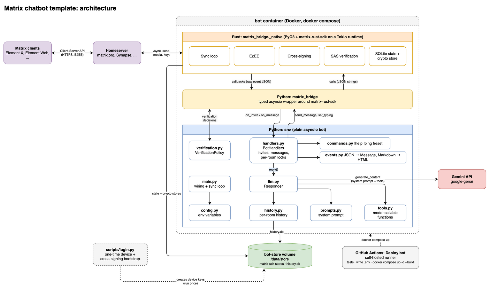

# Matrix chatbot template

A template for Matrix bots that answer with an LLM (Gemini by default), with a
few chat commands, tool calling, end-to-end encryption, and **interactive
verification**, so you can verify the bot from Element X like any other user.

Copy the repo, then adapt the prompt, tools, commands and handlers (see
[Adapting the template](#adapting-the-template)). It runs as a Docker container
deployed with `docker compose` from a GitHub Actions workflow on a self-hosted
runner.

For how each component works in detail, see [`docs/`](docs/README.md).

## Architecture


*Architecture of the Matrix Chatbot Template project.*

```
bot/
├── matrix_bridge/          # Rust ↔ Python bridge (PyO3 + maturin)
│   ├── src/lib.rs          #   matrix-rust-sdk: sync, E2EE, cross-signing, SAS verification
│   └── python/matrix_bridge/client.py   # typed async Python API — use this
├── src/                    # the bot itself, plain asyncio Python
│   ├── main.py             #   wiring + sync loop
│   ├── handlers.py         #   invites, messages, command dispatch
│   ├── commands.py         #   !help, !ping, !reset
│   ├── llm.py              #   Gemini responder (history + automatic tool calling)
│   ├── prompts.py          #   system prompt
│   ├── tools.py            #   functions the model may call
│   ├── verification.py     #   who may verify the bot, what to post while verifying
│   ├── history.py          #   per-room conversation history (SQLite)
│   ├── events.py           #   raw event JSON → Message, Markdown → HTML content
│   └── config.py           #   environment variables
├── scripts/login.py        # one-time device + cross-signing bootstrap
└── tests/
```

**Why Rust?** `matrix-nio` can't do cross-signing or in-room verification, and
Element X verifies other users with in-room verification (the whole SAS
handshake as events in your DM). [matrix-rust-sdk](https://github.com/matrix-org/matrix-rust-sdk)
(the SDK Element X itself is built on) supports both. No official Python
bindings exist, so `matrix_bridge` is a small PyO3 extension. It keeps the
protocol work in Rust and gives Python a narrow async API:

- `MatrixClient.login(...)` / `MatrixClient.restore(...)`
- `set_handlers(events=..., verification=...)`: async callbacks `on_invite`,
  `on_message` (raw event JSON as a dict), and the verification decisions
- `sync_forever()`, `send_message(room_id, content)`, `set_typing`,
  `join_room`, `get_event`, `download_media`
- `bootstrap_cross_signing(password)`, `reset_cross_signing(...)`, `cross_signing_status()`

Events reach Python as raw JSON and messages are sent as raw content dicts, so
most changes (new message types, reactions, replies, formatting) happen in
Python and never need a Rust rebuild.

## 1. Register the bot's Matrix account

Create a dedicated account for the bot (e.g. via https://app.element.io).
Don't reuse your personal account. Note its user ID, e.g. `@mybot:matrix.org`.

## 2. Get a Gemini API key

Create one at https://aistudio.google.com/apikey.

## 3. Bootstrap the bot's device (one-time, on the runner host)

The crypto keys, including the bot's cross-signing keys, are created by a real
login. They must then live forever in the same Docker volume the running bot
uses. So run this **on the self-hosted runner machine**:

```bash
cp .env.example .env   # only needed so `docker compose run` has a build context
docker compose build bot
docker compose run --rm \
  -e MATRIX_HOMESERVER=https://matrix.org \
  -e MATRIX_USER_ID=@mybot:matrix.org \
  bot python -m scripts.login
```

It asks for the password, logs in, and uploads the device keys. It also creates
the bot's **cross-signing identity** and signs its device with it, which lets
Element X show the bot as verified once you verify it. Finally it prints
`MATRIX_ACCESS_TOKEN` and `MATRIX_DEVICE_ID`.

If the account already has a cross-signing identity (someone logged into it
with Element before), the script offers to reset it, since a new device can't
sign itself without those keys. On homeservers that use OAuth (MAS), the reset
has to be approved in a browser, and the script prints the URL.

**Never delete the `bot-store` volume** (or run `docker compose down -v`).
Losing it while keeping the device ID breaks decryption permanently. You would
have to log out the old device and repeat this step. If you set
`MATRIX_STORE_PASSPHRASE`, pass the same value here with `-e` and never change it.

## 4. Configure GitHub Actions

In Settings → Secrets and variables → Actions (environment `prod`):

| Name | Kind | Value |
|---|---|---|
| `MATRIX_HOMESERVER` | variable | `https://matrix.org` |
| `MATRIX_USER_ID` | variable | `@mybot:matrix.org` |
| `MATRIX_ACCESS_TOKEN` | secret | from step 3 |
| `MATRIX_DEVICE_ID` | secret | from step 3 |
| `MATRIX_STORE_PASSPHRASE` | secret | (optional) must match step 3 |
| `MATRIX_ALLOWED_USERS` | variable | comma-separated MXIDs allowed to invite, talk to and verify the bot |
| `MATRIX_ALLOWED_ROOMS` | variable | (optional) comma-separated room IDs, additive with the user allowlist |
| `GEMINI_API_KEY` | secret | from step 2 |
| `GEMINI_MODEL` | variable | (optional) defaults to `gemini-3.5-flash-lite` |
| `LOG_LEVEL` | variable | (optional) defaults to `INFO` |

At least one of `MATRIX_ALLOWED_USERS` / `MATRIX_ALLOWED_ROOMS` is required.

## 5. Deploy

Push to `main` (touching `bot/**`, `docker-compose.yml` or the workflow), or
run **Deploy bot** manually. It runs the Python tests, writes `.env`, and runs
`docker compose up -d --build` on the runner. The first build compiles
matrix-rust-sdk, which takes several minutes. Later builds reuse Docker's cache
unless `matrix_bridge/` changes.

## 6. Chat and verify

From an account in `MATRIX_ALLOWED_USERS`, start a DM with the bot and send a
message. Try `!help`.

To verify the bot from **Element X**: open the bot's profile from the DM,
choose **Verify**, and start verification. The bot accepts automatically and
posts the emojis it sees as a notice in the DM. Compare them with the emojis on
your screen, and tap **They match** only if they're identical. The bot confirms
on its side automatically, since there's no human there to compare. Your
comparison is the check that protects you.

Requests from users who aren't in `MATRIX_ALLOWED_USERS` are cancelled.

## Adapting the template

| To change | Edit |
|---|---|
| Persona / instructions | `src/prompts.py` |
| What the model can do | `src/tools.py`: add a typed function with a docstring, list it in `TOOLS` |
| Chat commands | `src/commands.py` (definition) + `src/handlers.py` (handler method) |
| Message types (voice, images, …) | `src/handlers.py::on_message`: `client.download_media(message.source["content"])` returns decrypted bytes |
| Who may verify / what gets posted | `src/verification.py` |
| LLM provider | `src/llm.py` (the only module that imports `google.genai`) |
| New Matrix capabilities | add a method to `NativeClient` in `matrix_bridge/src/lib.rs` and a wrapper in `client.py` |

## Local development

Dependencies are managed with [uv](https://docs.astral.sh/uv/).

**Python only** (no Rust toolchain needed). The tests never import the bridge:

```bash
cd bot
uv sync --no-install-package matrix-bridge
uv run --no-sync pytest
```

**Full build**, including the bridge, needs a Rust toolchain
([rustup](https://rustup.rs), Rust ≥ 1.93):

```bash
cd bot
uv sync            # compiles matrix_bridge via maturin (slow the first time)
uv run python -c "import matrix_bridge; print(matrix_bridge.MatrixClient)"
```

After changing `lib.rs`, run `uv sync --reinstall-package matrix-bridge` to
rebuild. `docker compose build` at the repo root builds the production image
without any local toolchain.

## Notes / limitations

- Conversation history is stored in SQLite in the `bot-store` volume, per room.
  Only a bounded window is sent to the model. `!reset` deletes a room's history.
- Tool-call steps aren't stored in history, only the final user/model turns.
- The bot processes only messages sent after it started. Messages received
  while it was down are skipped.
- Only SAS (emoji) verification is supported; QR-code verification isn't
  compiled in.
- Set `MATRIX_SDK_LOG_LEVEL=debug` to see the Rust SDK's own logs.
