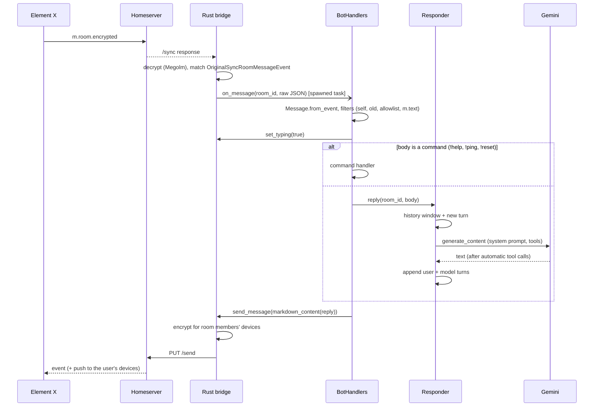

# Architecture

## Layers

```
┌──────────────────────────────────────────────────────────────────────┐
│ Matrix clients (Element X, Element Web, …)                           │
└───────────────▲──────────────────────────────────────────────────────┘
                │ Client-Server API (HTTPS), E2EE end to end
┌───────────────┴──────────────────────────────────────────────────────┐
│ Homeserver (matrix.org, Synapse, …)                                  │
└───────────────▲──────────────────────────────────────────────────────┘
                │ /sync long-poll, send, media, keys
┌───────────────┴──────────────────────────────────────────────────────┐
│ bot container                                                        │
│                                                                      │
│  Rust: matrix_bridge._native  (matrix-rust-sdk on a Tokio runtime)   │
│   sync · Olm/Megolm crypto · cross-signing · SAS state machine ·     │
│   SQLite state + crypto store (/data/store)                          │
│                 │ callbacks (raw JSON)   ▲ calls (JSON strings)      │
│  Python: matrix_bridge.client.MatrixClient  (typed asyncio wrapper)  │
│                 │                        ▲                           │
│  Python: src/   (plain asyncio bot)                                  │
│   main ─ handlers ─ commands                                         │
│             │                                                        │
│             ├─ llm ─ prompts, tools ──────────► Gemini API           │
│             ├─ history (SQLite, /data/store/history.db)              │
│           verification                                               │
└──────────────────────────────────────────────────────────────────────┘
```

Design rules that shape the code:

- **Protocol work lives in Rust, decisions live in Python.** The bridge does
  sync, encryption and verification. Python only gets asked questions ("accept
  this verification?") and receives events.
- **The boundary is JSON.** Events cross into Python as raw event JSON, and
  Python sends raw `content` dicts. New message types, replies, reactions or
  formatting need no Rust rebuild.
- **Only `llm.py` knows about the LLM provider.** Swapping Gemini touches one
  module.
- **Tests never import the bridge**, so they run without a Rust toolchain.

## Process model

- One process, one asyncio event loop (Python) plus a multi-threaded Tokio
  runtime (Rust), both owned by `pyo3-async-runtimes`.
- `main.py` restores the session, wires up the handlers, and awaits
  `client.sync_forever()` until `SIGTERM`/`SIGINT`.
- The Rust sync loop never waits on Python: every event callback is spawned as
  its own task (`Inner::spawn_call`), so a slow LLM call doesn't stall syncing.
- Since callbacks run concurrently, `BotHandlers` holds a lock per room to keep
  replies in the order messages arrived.

## Life of a message



Verification follows a different path: the Rust side recognises the request
(in-room or to-device) and drives the SAS state machine, calling into
`VerificationPolicy` only for decisions. See [verification.md](verification.md).

## Persistent state

Everything that must survive restarts lives in the `bot-store` Docker volume,
mounted at `/data/store`:

| File(s) | Owner | Losing it means |
|---|---|---|
| matrix-sdk SQLite state + crypto stores | Rust bridge | The device can no longer decrypt; you need a new login (see [deployment.md](deployment.md)) |
| `history.db` | `src/history.py` | The bot forgets past conversations |

## Where to extend

| Goal | Where |
|---|---|
| Persona | `src/prompts.py` |
| New capability for the model | `src/tools.py` |
| New chat command | `src/commands.py` + `src/handlers.py` |
| Images, voice, files | `src/handlers.py::on_message` + `client.download_media` |
| Reactions, edits, threads (sending) | `src/events.py` content builders; `send_message(..., event_type=...)` |
| New *received* event types (reactions, state events, …) | Register a handler in `lib.rs::register_event_handlers` |
| Different LLM | `src/llm.py` |
